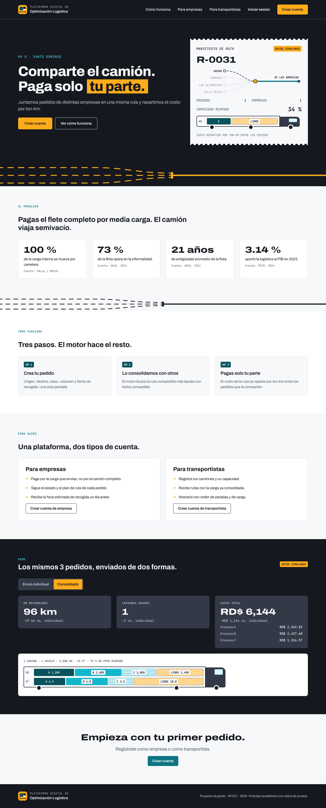

# Plataforma Digital de Optimización Logística · Prototipo

Proyecto de grado de Ingeniería de Sistemas (INTEC, 2026). Plataforma web que consolida pedidos de distintas empresas en rutas compartidas y reparte el costo del transporte por ton-km, para el transporte de carga terrestre en República Dominicana.

Este repositorio guarda el prototipo de interfaz y la base del front-end.



## Contenido

| Carpeta | Qué tiene |
|---|---|
| [`diseno/`](diseno/) | Prototipo en Figma: capturas de las 57 pantallas y overlays, tokens de diseño, guía de estilos, archivo `.fig`, plugins y principios de UI aplicados. |
| [`app/`](app/) | Front-end en React + Vite + Tailwind con los tokens del diseño. Por ahora: landing, inicio de sesión y panel de empresa. |

## Enlaces

- Prototipo navegable en Figma: https://www.figma.com/proto/jgyMWiNMdltQbrvLgArYma?node-id=12-57&starting-point-node-id=12%3A57
- Archivo de diseño: https://www.figma.com/design/jgyMWiNMdltQbrvLgArYma

## Roles

- **Empresa:** crea pedidos, ve cómo se consolidan, sigue el estado y descarga el recibo.
- **Transportista:** registra camiones y recibe rutas con la carga ya consolidada.

## Ejecutar el front-end

```bash
cd app
npm install
npm run dev
```

## Estado

| Parte | Estado |
|---|---|
| Diseño de interfaz (Figma) | Completo: flujos de empresa y transportista, perfil y seguridad, detalle de pedido por estado, prototipo con interacciones. |
| Front-end | Iniciado: 3 pantallas en código, resto con marcador. |
| Backend y motor de ruteo | Pendiente. |

Prototipo académico con datos de prueba.
