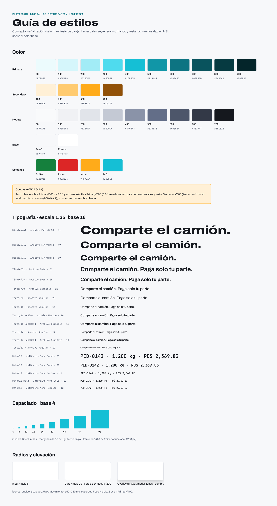

# Guía de estilos

Logo: [`logo.svg`](logo.svg). Valores completos en [`../tokens/tokens.json`](../tokens/tokens.json).

## Color

| Grupo | Uso | Valores |
|---|---|---|
| Primary | Marca, acción principal sobre fondo claro, enlaces, foco | 50 #ECFBFD · 100 #D5F6FB · 200 #A2ECF6 · 300 #4FDBEE · 400 #15BFD5 · 500 #1196A7 · 600 #0D7482 · 700 #09535D · 800 #063A41 · 900 #04252A |
| Secondary | Ámbar: acción principal sobre fondo oscuro, avisos | 100 #FFF0D6 · 300 #FFCB70 · 500 #FFAB1A · 700 #915108 |
| Neutral | Texto, bordes, superficies | 50 #F9FAFB · 100 #F0F1F4 · 200 #E1E4EA · 300 #C4C9D4 · 400 #8A93A8 · 500 #636E88 · 600 #4D566A · 700 #333947 · 900 #15181E |
| Base | Fondos | Papel #F7F8FA · Blanco #FFFFFF |
| Semantic | Estados | Éxito #15803D · Error #DC2626 · Aviso #FFAB1A · Info #15BFD5 |

## Tipografía

- **Archivo** para títulos y texto.
- **JetBrains Mono** para datos: montos, códigos de pedido, placas, kilómetros.

| Estilo | Fuente | Tamaño / interlineado |
|---|---|---|
| Display/61 · 49 · 39 | Archivo ExtraBold | 61/102 % · 49/105 % · 39/110 % |
| Título/31 · 25 | Archivo Bold | 31/115 % · 25/120 % |
| Título/20 | Archivo SemiBold | 20/130 % |
| Texto/20 | Archivo Regular | 20/145 % |
| Texto/16 (Regular, Medium, SemiBold) | Archivo | 16/150 % |
| Texto/14 (Regular, SemiBold) | Archivo | 14/150 % |
| Texto/12 | Archivo Regular | 12/150 % |
| Dato/25 · 20 | JetBrains Mono Bold | 25/120 % · 20/120 % |
| Dato/14 | JetBrains Mono Medium | 14/140 % |
| Dato/12 (Regular, Bold) | JetBrains Mono | 12/140 % |

## Medidas

- **Espaciado:** 4 · 8 · 12 · 16 · 24 · 32 · 48 · 64 · 96 px.
- **Radios:** campos 6 px · tarjetas 10 px.

Reglas de uso del color y del contraste: [`../principios-ui.md`](../principios-ui.md).
