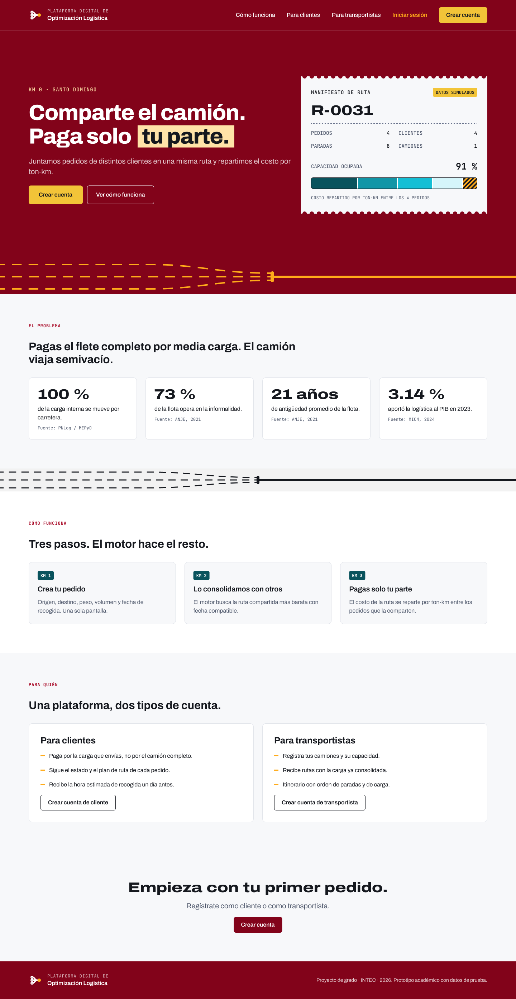

# Diseño v2 · propuesta

Copia mejorada del prototipo (23 nov 2026). **Es una propuesta:** los colores pueden cambiar, así que la versión vigente sigue siendo la de [`../`](../) y el front-end de [`app/`](../../app/) todavía usa los tokens de v1.

- **Archivo de Figma:** https://www.figma.com/design/TQ9yKuC1p2ihW8lOYngzdK
- **Prototipo:** https://www.figma.com/proto/TQ9yKuC1p2ihW8lOYngzdK?node-id=12-57&starting-point-node-id=12%3A57

## Qué cambia frente a v1

| | v1 | v2 |
|---|---|---|
| Color de marca | Grafito (`Neutral/900`) con ámbar para la acción principal | Rojo (`Marca/Rojo 700` #82031A) en barra lateral, hero, correo y botón principal; amarillo (`Secondary/400`) para badges y cifras |
| Primary (teal) | Color de acción | Solo datos, estados ("Asignado a ruta", "Final") e ilustraciones de carga |
| Enlaces | `Primary/600` | `Semantic/Enlace` #006ECF |
| Fondo del contenido | `Base/Papel` | `Base/Fondo` #F2F2F2, con tarjetas en blanco |
| Logo | Camión sobre ámbar | "Ruta consolidada": tres orígenes que se unen en una línea, sobre rojo, con punto ámbar |
| Roles | Empresa y transportista | Cinco roles (abajo) |
| Pantallas | 57 + overlays | 79 + overlays, incluidas las de admin, conductor, cliente admin y errores |
| Nombres | "Empresa" | "Cliente" para quien envía la carga |

Tipografía, espaciado, radios y la escala Primary, Neutral y Semantic no cambian. Tokens completos en [`tokens/`](tokens/), guía visual en [`guia-de-estilos/`](guia-de-estilos/).

## Roles y permisos

| Rol | Qué puede hacer |
|---|---|
| Cliente · usuario de sucursal | Crea pedidos y ve solo los de su sucursal. No ve otras sucursales, ni facturación, ni usuarios. |
| Cliente · administrador de empresa | Ve y administra todo lo de la empresa: sucursales, usuarios, facturación y datos. También crea pedidos. |
| Transportista · conductor | Ve solo las rutas que le asignan: paradas, carga y contactos. Confirma entregas y reporta incidencias. No ve ganancias, flota ni rutas de otros conductores. |
| Transportista · administrador de empresa | Ve todo lo de la empresa de transporte: rutas, flota, conductores, ganancias y datos. |
| Administrador de la plataforma | Opera la plataforma: aprueba cuentas, ve todos los pedidos y rutas, atiende incidencias y configura el sistema. |

## Reglas de color (WCAG AA)

- `Marca/Rojo 700` es el color de marca; texto blanco sobre él da 10.6:1.
- `Marca/Rojo 600` marca el ítem activo de la navegación (fondo blanco), las etiquetas en mayúsculas y el foco visible (7.9:1 sobre blanco). `Marca/Rojo 800` para tarjetas sobre rojo y hover del botón principal. `Marca/Rojo 50` para opción seleccionada.
- Sobre rojo: texto blanco; secundario blanco al 72 %; ítem inactivo blanco al 80 %; divisores blanco al 24 %.
- `Semantic/Enlace` para enlaces de texto (5.1:1 sobre blanco, 4.5:1 sobre `Base/Fondo`).
- `Secondary/200` para resaltar cifras clave y `Secondary/400` para badges, ambos con texto `Neutral/900`. `Secondary/500` queda para ilustraciones y el punto del logo.
- Íconos Lucide con trazo de 1.5 px; movimiento de 150 a 250 ms, ease-out; foco de 2 px en `Marca/Rojo 600`.

## Inventario de pantallas

89 capturas a 1440 px de ancho. No se incluyen las exploraciones, los 15 toasts ni las pantallas marcadas como "Repetidas" en Figma.

### Públicas (8)

| Pantalla | Captura |
|---|---|
| 01 · Landing | [ver](capturas/01-landing.png) |
| 02 · Registro | [ver](capturas/02-registro.png) |
| 02b · Registro · segundo camión | [ver](capturas/02b-registro-segundo-camion.png) |
| 02c · Registro · Cliente | [ver](capturas/02c-registro-cliente.png) |
| 03 · Inicio de sesión | [ver](capturas/03-inicio-de-sesion.png) |
| 03b · Verificación en dos pasos (inicio de sesión) | [ver](capturas/03b-verificacion-en-dos-pasos-inicio-de-sesion.png) |
| 04 · Recuperar contraseña | [ver](capturas/04-recuperar-contrasena.png) |
| 04b · Recuperar contraseña · solicitud recibida | [ver](capturas/04b-recuperar-contrasena-solicitud-recibida.png) |

### Errores (6)

| Pantalla | Captura |
|---|---|
| E0 · Error genérico · Ups, algo salió mal | [ver](capturas/e0-error-generico-ups-algo-salio-mal.png) |
| E1 · Error 404 · Página no encontrada | [ver](capturas/e1-error-404-pagina-no-encontrada.png) |
| E2 · Error 500 · Algo salió mal | [ver](capturas/e2-error-500-algo-salio-mal.png) |
| E3 · Error 403 · Sin acceso | [ver](capturas/e3-error-403-sin-acceso.png) |
| E4 · Error 401 · Sesión vencida | [ver](capturas/e4-error-401-sesion-vencida.png) |
| E5 · Cliente (sucursal) · Panel · error al cargar | [ver](capturas/e5-cliente-sucursal-panel-error-al-cargar.png) |

### Cliente · usuario de sucursal (11)

| Pantalla | Captura |
|---|---|
| 05 · Cliente (sucursal) · Panel | [ver](capturas/05-cliente-sucursal-panel.png) |
| 06 · Cliente (sucursal) · Nuevo pedido | [ver](capturas/06-cliente-sucursal-nuevo-pedido.png) |
| 07a · Cliente (sucursal) · Evaluando rutas | [ver](capturas/07a-cliente-sucursal-evaluando-rutas.png) |
| 07a0 · Cliente (sucursal) · Evaluando rutas · cargando | [ver](capturas/07a0-cliente-sucursal-evaluando-rutas-cargando.png) |
| 07b · Cliente (sucursal) · Pedido asignado | [ver](capturas/07b-cliente-sucursal-pedido-asignado.png) |
| 08 · Cliente (sucursal) · Pedidos de la sucursal | [ver](capturas/08-cliente-sucursal-pedidos-de-la-sucursal.png) |
| 08b · Cliente (sucursal) · Pedidos de la sucursal · sin pedidos | [ver](capturas/08b-cliente-sucursal-pedidos-de-la-sucursal-sin-pedidos.png) |
| 09a · Cliente (sucursal) · Detalle · Resumen | [ver](capturas/09a-cliente-sucursal-detalle-resumen.png) |
| 09b · Cliente (sucursal) · Detalle · Plan de ruta | [ver](capturas/09b-cliente-sucursal-detalle-plan-de-ruta.png) |
| 09c · Cliente (sucursal) · Detalle · Recibo | [ver](capturas/09c-cliente-sucursal-detalle-recibo.png) |
| 10u · Cliente (sucursal) · Mi perfil | [ver](capturas/10u-cliente-sucursal-mi-perfil.png) |

### Cliente · usuario de sucursal · detalle por pedido (15)

| Pantalla | Captura |
|---|---|
| 09a · Cliente (sucursal) · Detalle · Resumen · PED-0117 | [ver](capturas/09a-cliente-sucursal-detalle-resumen-ped-0117.png) |
| 09a · Cliente (sucursal) · Detalle · Resumen · PED-0124 | [ver](capturas/09a-cliente-sucursal-detalle-resumen-ped-0124.png) |
| 09a · Cliente (sucursal) · Detalle · Resumen · PED-0131 | [ver](capturas/09a-cliente-sucursal-detalle-resumen-ped-0131.png) |
| 09a · Cliente (sucursal) · Detalle · Resumen · PED-0139 | [ver](capturas/09a-cliente-sucursal-detalle-resumen-ped-0139.png) |
| 09a · Cliente (sucursal) · Detalle · Resumen · PED-0148 | [ver](capturas/09a-cliente-sucursal-detalle-resumen-ped-0148.png) |
| 09b · Cliente (sucursal) · Detalle · Plan de ruta · PED-0117 | [ver](capturas/09b-cliente-sucursal-detalle-plan-de-ruta-ped-0117.png) |
| 09b · Cliente (sucursal) · Detalle · Plan de ruta · PED-0124 | [ver](capturas/09b-cliente-sucursal-detalle-plan-de-ruta-ped-0124.png) |
| 09b · Cliente (sucursal) · Detalle · Plan de ruta · PED-0131 | [ver](capturas/09b-cliente-sucursal-detalle-plan-de-ruta-ped-0131.png) |
| 09b · Cliente (sucursal) · Detalle · Plan de ruta · PED-0139 | [ver](capturas/09b-cliente-sucursal-detalle-plan-de-ruta-ped-0139.png) |
| 09b · Cliente (sucursal) · Detalle · Plan de ruta · PED-0148 | [ver](capturas/09b-cliente-sucursal-detalle-plan-de-ruta-ped-0148.png) |
| 09c · Cliente (sucursal) · Detalle · Recibo · PED-0117 | [ver](capturas/09c-cliente-sucursal-detalle-recibo-ped-0117.png) |
| 09c · Cliente (sucursal) · Detalle · Recibo · PED-0124 | [ver](capturas/09c-cliente-sucursal-detalle-recibo-ped-0124.png) |
| 09c · Cliente (sucursal) · Detalle · Recibo · PED-0131 | [ver](capturas/09c-cliente-sucursal-detalle-recibo-ped-0131.png) |
| 09c · Cliente (sucursal) · Detalle · Recibo · PED-0139 | [ver](capturas/09c-cliente-sucursal-detalle-recibo-ped-0139.png) |
| 09c · Cliente (sucursal) · Detalle · Recibo · PED-0148 | [ver](capturas/09c-cliente-sucursal-detalle-recibo-ped-0148.png) |

### Cliente · administrador de empresa (13)

| Pantalla | Captura |
|---|---|
| 10 · Cliente (admin) · Perfil | [ver](capturas/10-cliente-admin-perfil.png) |
| 10b · Cliente (admin) · Perfil · Seguridad | [ver](capturas/10b-cliente-admin-perfil-seguridad.png) |
| 10c · Cliente (admin) · Perfil · Verificación en dos pasos (desactivada) | [ver](capturas/10c-cliente-admin-perfil-verificacion-en-dos-pasos-desactivada.png) |
| 10d · Cliente (admin) · Perfil · Activar verificación | [ver](capturas/10d-cliente-admin-perfil-activar-verificacion.png) |
| 10f · Cliente (admin) · Perfil · Pedidos completados | [ver](capturas/10f-cliente-admin-perfil-pedidos-completados.png) |
| 10g · Cliente (admin) · Perfil · Notificaciones | [ver](capturas/10g-cliente-admin-perfil-notificaciones.png) |
| 10h · Cliente (admin) · Perfil · Equipo y permisos | [ver](capturas/10h-cliente-admin-perfil-equipo-y-permisos.png) |
| 10i · Cliente (admin) · Perfil · Privacidad y datos | [ver](capturas/10i-cliente-admin-perfil-privacidad-y-datos.png) |
| CA1 · Cliente (admin) · Panel de la empresa | [ver](capturas/ca1-cliente-admin-panel-de-la-empresa.png) |
| CA2 · Cliente (admin) · Pedidos de la empresa | [ver](capturas/ca2-cliente-admin-pedidos-de-la-empresa.png) |
| CA3 · Cliente (admin) · Sucursales | [ver](capturas/ca3-cliente-admin-sucursales.png) |
| CA4 · Cliente (admin) · Usuarios | [ver](capturas/ca4-cliente-admin-usuarios.png) |
| CA5 · Cliente (admin) · Facturación | [ver](capturas/ca5-cliente-admin-facturacion.png) |

### Transportista · conductor (5)

| Pantalla | Captura |
|---|---|
| 13b · Conductor · Ruta en curso | [ver](capturas/13b-conductor-ruta-en-curso.png) |
| 13c · Conductor · Confirmar entrega | [ver](capturas/13c-conductor-confirmar-entrega.png) |
| 13d · Conductor · Reportar incidencia | [ver](capturas/13d-conductor-reportar-incidencia.png) |
| C1 · Conductor · Mis rutas | [ver](capturas/c1-conductor-mis-rutas.png) |
| C2 · Conductor · Perfil | [ver](capturas/c2-conductor-perfil.png) |

### Transportista · administrador de empresa (13)

| Pantalla | Captura |
|---|---|
| 11 · Transportista (admin) · Panel | [ver](capturas/11-transportista-admin-panel.png) |
| 11b · Transportista (admin) · Rutas de la empresa | [ver](capturas/11b-transportista-admin-rutas-de-la-empresa.png) |
| 12 · Transportista (admin) · Flota | [ver](capturas/12-transportista-admin-flota.png) |
| 13 · Transportista (admin) · Ruta asignada | [ver](capturas/13-transportista-admin-ruta-asignada.png) |
| 14 · Transportista (admin) · Perfil | [ver](capturas/14-transportista-admin-perfil.png) |
| 14b · Transportista (admin) · Perfil · Seguridad | [ver](capturas/14b-transportista-admin-perfil-seguridad.png) |
| 14c · Transportista (admin) · Perfil · Verificación en dos pasos (desactivada) | [ver](capturas/14c-transportista-admin-perfil-verificacion-en-dos-pasos-desactivada.png) |
| 14d · Transportista (admin) · Perfil · Activar verificación | [ver](capturas/14d-transportista-admin-perfil-activar-verificacion.png) |
| 14f · Transportista (admin) · Perfil · Rutas completadas | [ver](capturas/14f-transportista-admin-perfil-rutas-completadas.png) |
| 14g · Transportista (admin) · Perfil · Notificaciones | [ver](capturas/14g-transportista-admin-perfil-notificaciones.png) |
| 14i · Transportista (admin) · Perfil · Privacidad y datos | [ver](capturas/14i-transportista-admin-perfil-privacidad-y-datos.png) |
| 16 · Transportista (admin) · Ganancias | [ver](capturas/16-transportista-admin-ganancias.png) |
| 17 · Transportista (admin) · Conductores | [ver](capturas/17-transportista-admin-conductores.png) |

### Administrador de la plataforma (7)

| Pantalla | Captura |
|---|---|
| A1 · Admin · Panel | [ver](capturas/a1-admin-panel.png) |
| A2 · Admin · Usuarios | [ver](capturas/a2-admin-usuarios.png) |
| A3 · Admin · Aprobar transportista | [ver](capturas/a3-admin-aprobar-transportista.png) |
| A4 · Admin · Pedidos | [ver](capturas/a4-admin-pedidos.png) |
| A5 · Admin · Rutas | [ver](capturas/a5-admin-rutas.png) |
| A6 · Admin · Incidencias | [ver](capturas/a6-admin-incidencias.png) |
| A7 · Admin · Configuración | [ver](capturas/a7-admin-configuracion.png) |

### Transversal (1)

| Pantalla | Captura |
|---|---|
| 15 · Correo de notificación | [ver](capturas/15-correo-de-notificacion.png) |

### Overlays (10)

| Pantalla | Captura |
|---|---|
| Overlay · Acciones de fila | [ver](capturas/overlays/acciones-de-fila.png) |
| Overlay · Actividad de la cuenta · Cliente | [ver](capturas/overlays/actividad-de-la-cuenta-cliente.png) |
| Overlay · Actividad de la cuenta · Transportista | [ver](capturas/overlays/actividad-de-la-cuenta-transportista.png) |
| Overlay · Administrar verificación · Cliente | [ver](capturas/overlays/administrar-verificacion-cliente.png) |
| Overlay · Cerrar las demás sesiones | [ver](capturas/overlays/cerrar-las-demas-sesiones.png) |
| Overlay · Editar camión L-284519 | [ver](capturas/overlays/editar-camion-l-284519.png) |
| Overlay · Eliminar cuenta | [ver](capturas/overlays/eliminar-cuenta.png) |
| Overlay · Invitar usuario | [ver](capturas/overlays/invitar-usuario.png) |
| Overlay · Política de privacidad | [ver](capturas/overlays/politica-de-privacidad.png) |
| Overlay · Vista rápida PED-0142 | [ver](capturas/overlays/vista-rapida-ped-0142.png) |

## Flujos del prototipo

A · Empresa crea un pedido · B · Transportista registra un camión · Inicio · Landing · C · Activar verificación en dos pasos · D · Seguridad de la cuenta · E · Correo de notificación · F · Mis pedidos sin pedidos.
